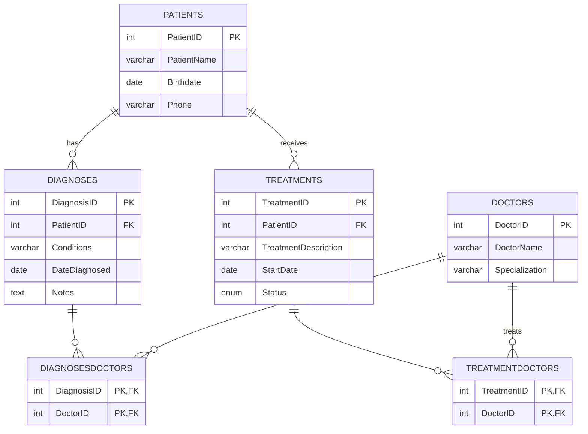

# 🏥 MedRecords — Electronic Medical Records (EMR) Database


A full relational database project for a small health-care clinic. The project runs from the
use case through the ER model, normalization to **3NF**, a **MySQL** schema, and a **C# WPF desktop app**
with full CRUD over patients, doctors, diagnoses and treatments.

> Built for **PROG2111 – Relational Databases (Fall 2025)**, Group 6.

---

## ✨ Features

- **Patients**: add, edit, and delete patient records, with phone-number validation
- **Doctors**: manage doctors and their specializations
- **Diagnoses**: record conditions per patient and assign one or more doctors
- **Treatments**: track treatments with status `Active` / `Completed` / `Cancelled` and assigned doctors
- **Auto-provisioning**: the app creates the `EMR_DB` database and all tables on first launch
- **Normalized storage with readable views**: data is stored in 3NF, then denormalized in memory so each grid shows patient names and doctor lists

## 🗂️ Database Design



Two junction tables, `DiagnosesDoctors` and `TreatmentDoctors`, resolve the many-to-many
relationships between doctors and the records they work on. Deleting a diagnosis or treatment
also deletes its doctor assignments (`ON DELETE CASCADE`).

## 📁 Project Structure

| Phase | Deliverable | Description |
|------:|-------------|-------------|
| 1–2 | [`Phase 1 - 2.docx`](Phase%201%20-%202.docx) | Project idea, use case, entities/attributes, and the ERD |
| 3 | [`Phase 3 - Normalization.docx`](Phase%203%20-%20Normalization.docx) | Normalization from 1NF to 3NF |
| 4 | [`Phase 4 - SQL DDL Statements.sql`](Phase%204%20-%20SQL%20DDL%20Statements.sql) | MySQL DDL script with PK/FK constraints |
| 5 | [`Phase 5 - MedRecordsApp/`](Phase%205%20-%20MedRecordsApp) | C# WPF desktop app with CRUD over ADO.NET |
| — | [`Group6_EMR_ProjectLog.pdf`](Group6_EMR_ProjectLog.pdf) | Team contribution log |

```
Phase 5 - MedRecordsApp/
└── MedRecordsApp/
    ├── DAL/        # DataManager + one helper per table (parameterized SQL)
    ├── Models/     # Patient, Doctor, Diagnosis, Treatment
    ├── Views/      # WPF user controls for each tab
    └── MainWindow.xaml(.cs)
```

## 🚀 Getting Started

### Prerequisites
- Windows with the [.NET 10 SDK](https://dotnet.microsoft.com/download) (or Visual Studio 2026)
- A running local [MySQL Server](https://dev.mysql.com/downloads/mysql/)

### Run the app
1. Clone the repository:
   ```bash
   git clone https://github.com/Happytyagi1/EMR-Medical-Records-Database.git
   cd "EMR-Medical-Records-Database/Phase 5 - MedRecordsApp"
   ```
2. Set your MySQL credentials in `MedRecordsApp/MainWindow.xaml.cs`:
   ```csharp
   private const string CONNECTION_STRING = "server=localhost;uid=root;pwd=1234";
   ```
3. Build and run:
   ```bash
   dotnet run --project MedRecordsApp
   ```
   The app creates the `EMR_DB` database and its tables on first launch.

### Create the schema without the app (optional)
```bash
mysql -u root -p < "Phase 4 - SQL DDL Statements.sql"
```
